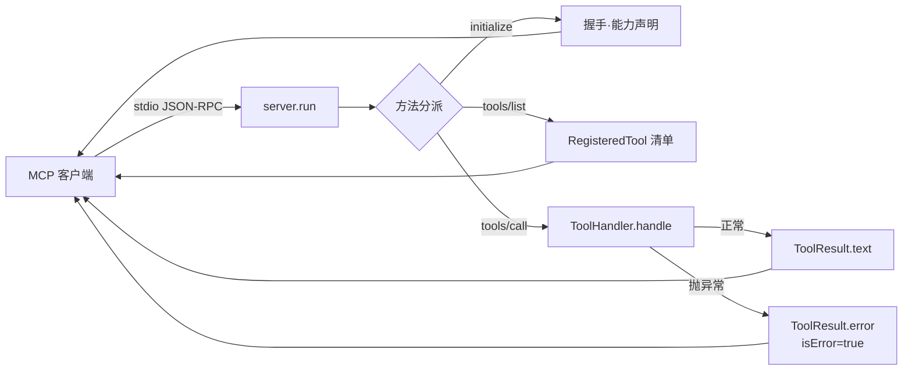

<div align="center">

# Aether

### 零依赖的 Java MCP 服务端框架 —— 把任意 Java 方法变成 AI 工具

[](https://github.com/WsNodeX/aether/stargazers)
[](https://github.com/WsNodeX/aether/releases)
[](LICENSE)

</div>

---

不引入任何第三方库，仅凭 JDK 标准库实现一个 MCP 工具服务器，可对接 Claude
Desktop 等任意 MCP 客户端。协议版本 `2024-11-05`，传输走 stdio。

## 为什么从零写

Java 侧的 MCP 实现通常要拖一整个生态进来。Aether 的约束是反过来的：**只用 JDK**。

- **零依赖**：`javac` 直接编译，没有 Gradle/Maven 依赖树。
- **协议层可读**：JSON-RPC 帧、`initialize` 握手、`tools/list`、`tools/call` 各
  自一个方法，你能顺着读完。
- **可单测**：`handleMessage(Json.parse(request))` 直接返回响应对象，不用起进程、
  不用连 stdio，测试里就是这么做的。
- **手写 JSON**：连 `Json` 解析器都是自己写的，所以整个仓库没有一处外部 import。

## 快速开始

```bash
git clone https://github.com/WsNodeX/aether.git
cd aether

# 编译主代码 + 测试代码
javac --release 17 -d build/classes $(find src/main/java -name '*.java')
javac --release 17 -cp build/classes -d build/test-classes $(find src/test/java -name '*.java')
```

跑一次示例交互，不需要任何客户端：

```bash
java -cp "build/classes" io.aether.demo.McpServerDemo --demo
```

它会打印几轮「客户端请求 → 服务端响应」，可以直接看到协议长什么样。

作为真正的 server 启动（进程阻塞在 stdio 上）：

```bash
java -cp "build/classes" io.aether.demo.McpServerDemo
```

内置四个工具演示：`calculator`（加减乘除）、`current_time`、`word_count`、`echo`。

## 核心 API

三行注册一个工具：

```java
McpServer server = McpServer.builder()
    .name("my-server")
    .version("1.0.0")
    .tool("add", "两数相加",
          "{\"type\":\"object\",\"properties\":{\"a\":{\"type\":\"number\"},\"b\":{\"type\":\"number\"}},\"required\":[\"a\",\"b\"]}",
          args -> {
              double a = ((Number) args.get("a")).doubleValue();
              double b = ((Number) args.get("b")).doubleValue();
              return ToolResult.text(String.valueOf(a + b));
          })
    .build();

server.run();   // 启动 stdio 事件循环
```

| 名字 | 作用 |
|---|---|
| `McpServer.builder()` | 流式配置：`.name()` `.version()` `.tool()` `.build()` |
| `.tool(name, description, inputSchemaJson, handler)` | 注册工具，schema 是标准 JSON Schema，注册时校验 |
| `ToolHandler` | 函数式接口 `Map<String,Object> -> ToolResult`，抛出的异常会被框架兜底成 `isError` |
| `ToolResult.text(...)` / `ToolResult.error(...)` | 成功 / 业务失败 |
| `server.handleMessage(...)` | 直接处理一条消息并返回响应，测试用 |
| `server.run()` | 阻塞在 stdio 上跑事件循环 |

## 请求怎么走



## 接入 Claude Desktop

在 `claude_desktop_config.json` 里加一段：

```json
{
  "mcpServers": {
    "aether-demo": {
      "command": "java",
      "args": ["-cp", "/绝对路径/aether/build/classes", "io.aether.demo.McpServerDemo"]
    }
  }
}
```

重启 Claude Desktop，工具列表里就会出现 `calculator` / `current_time` 等。

## 测试

```bash
java -cp "build/classes:build/test-classes:junit-platform-console-standalone.jar" \
     org.junit.platform.console.ConsoleLauncher --scan-class-path
```

## 限制

- **stdio 传输 only。** 没有 HTTP/SSE 传输，一个进程对一个客户端。
- **手写 JSON 解析器。** 够用且零依赖，但不要拿它处理不可信的大 payload——它没做过
  模糊测试。
- **单线程事件循环。** 工具处理器是串行调用的，长耗时工具会阻塞后续请求。
- **没有 JDK 与 Gradle wrapper 的自动化构建。** 构建靠 `javac` 命令，CI 里也是这么写的。

## 许可

[MIT](LICENSE)
